<div align="center">

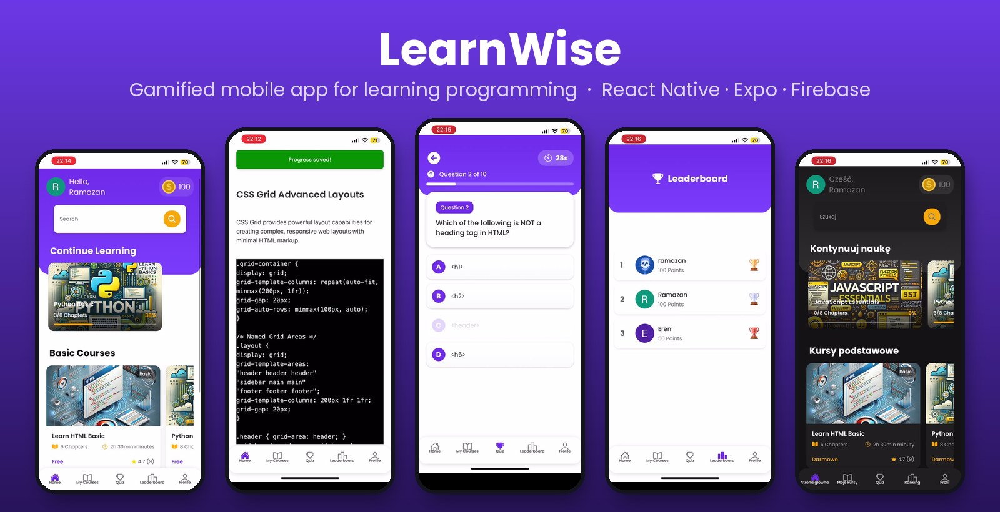

# LearnWise

**A gamified, cross-platform mobile app that turns learning to code into a habit.**

Structured courses · Runnable code examples · Timed quizzes · Points & leaderboard · Dark mode · 🇬🇧 🇹🇷 🇵🇱


🎓 **Bachelor's thesis project** &nbsp;·&nbsp; 💼 **Acquired by an EdTech company in Turkey**

</div>

---

## 🎬 Demo

<div align="center">
  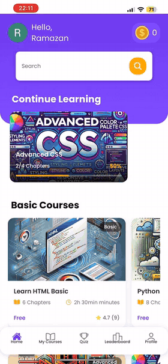
  <br/>
  <sub>35-second highlight reel · <a href="docs/learnwise-demo.mp4"><b>▶ Watch the full walkthrough (3 min)</b></a></sub>
</div>

---

## 💡 Why LearnWise?

People who start learning to program usually quit for the same reasons: resources are **scattered**, there is **no clear sense of progress**, and **motivation fades** after the first few lessons. Popular apps cover the basics but offer little in terms of progress tracking or reasons to come back tomorrow.

LearnWise tackles this with three ideas:

| Problem | LearnWise's answer |
|---|---|
| Scattered, unstructured content | One app, four languages (**HTML, CSS, JavaScript, Python**) with **Basic → Advanced** paths split into short chapters |
| "Am I actually getting anywhere?" | Per-chapter progress bars, *In Progress / Completed* journey view, saved progress across devices |
| Motivation drops off | **Points** for every finished chapter, **timed quizzes**, a **global leaderboard** with gold/silver/bronze ranks, course ratings |
| Not everyone learns the same way | **Dark mode** and **3 UI languages** (English, Turkish, Polish), remembered per user |

The design is grounded in learning theory covered in the thesis: active learning (Piaget), self-efficacy (Bandura), flow (Csikszentmihalyi) and self-determination theory (Deci & Ryan).

---

## ✨ Features

### 📚 Courses & lessons
- Courses grouped by level (**Basic / Advanced**) with chapter count, duration, author and rating
- Each chapter is a sequence of steps: explanation → **code example → "Run" to reveal the output** → *Save & Continue*
- Locked/unlocked chapters, completion check-marks and a step progress bar
- Instant **search** to filter courses and a **Continue Learning** carousel on the home screen

### 🎮 Gamification
- **+50 points** for every newly completed chapter (no double-counting on replays), with a celebration screen and **5-star course rating**
- **Timed quizzes** (10 questions, 30 s per question) for HTML, CSS and JavaScript
- Animated result screen (Lottie) with score and accuracy, and the option to retry
- **Leaderboard** ranking all users by points

### 👤 Personalisation
- **Sign in with Google** via Clerk (secure session handling with `expo-secure-store`)
- **My Learning Journey** – in-progress and completed courses at a glance
- **Light / Dark theme** via a custom `ThemeContext`
- **EN / TR / PL** localisation with `i18next`; language choice persisted in `AsyncStorage`

---

## 📱 Screenshots

<table>
  <tr>
    <td align="center">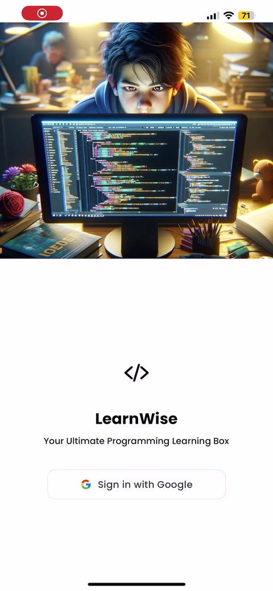<br/><sub><b>Google sign-in</b></sub></td>
    <td align="center">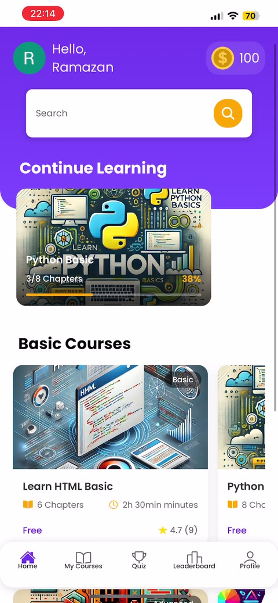<br/><sub><b>Home</b></sub></td>
    <td align="center">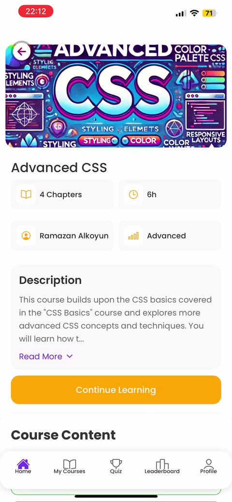<br/><sub><b>Course details</b></sub></td>
    <td align="center">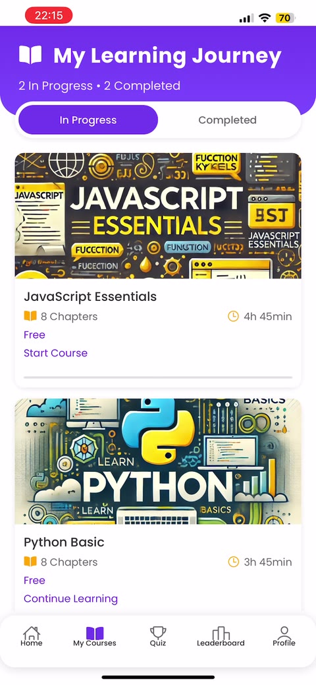<br/><sub><b>Learning journey</b></sub></td>
  </tr>
  <tr>
    <td align="center">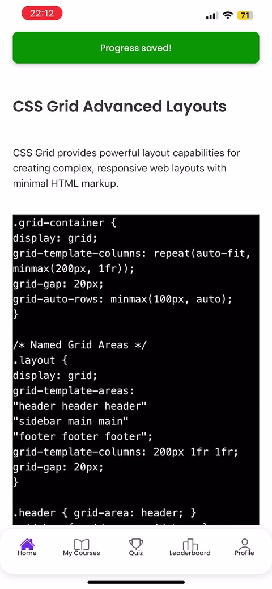<br/><sub><b>Lesson with code</b></sub></td>
    <td align="center">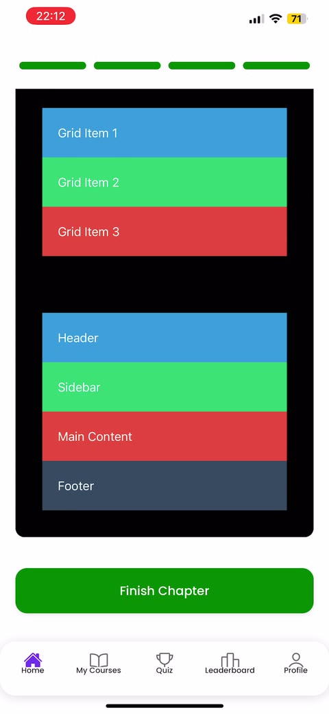<br/><sub><b>Run → live output</b></sub></td>
    <td align="center">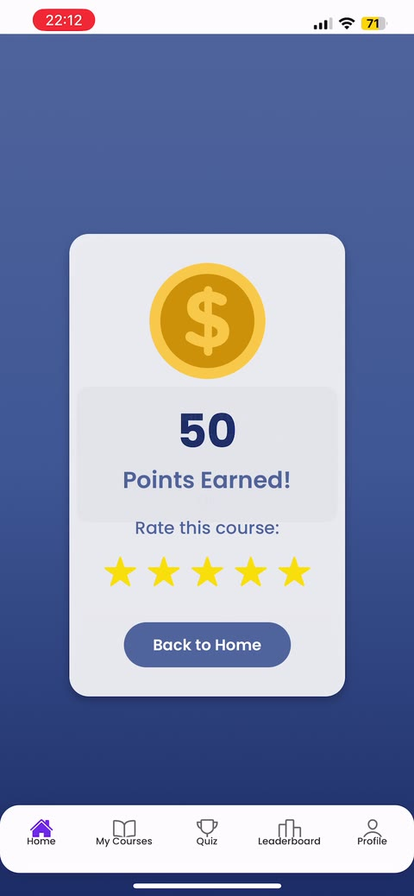<br/><sub><b>Points & rating</b></sub></td>
    <td align="center">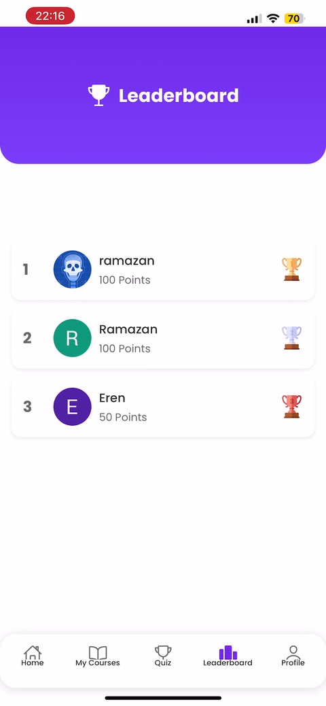<br/><sub><b>Leaderboard</b></sub></td>
  </tr>
  <tr>
    <td align="center">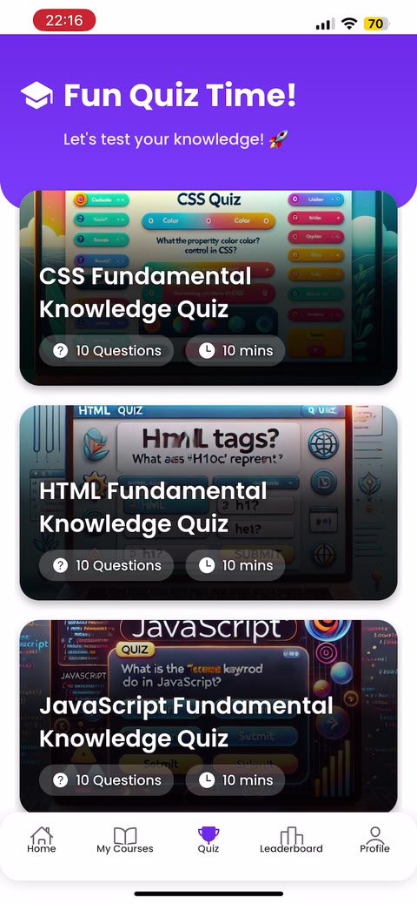<br/><sub><b>Quiz catalogue</b></sub></td>
    <td align="center">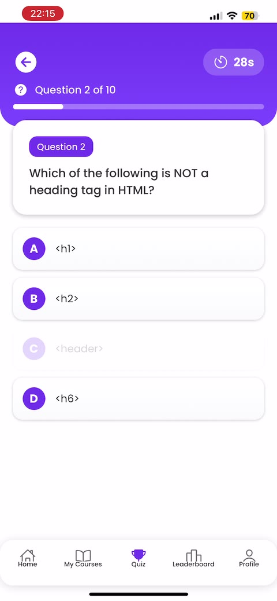<br/><sub><b>Timed question</b></sub></td>
    <td align="center">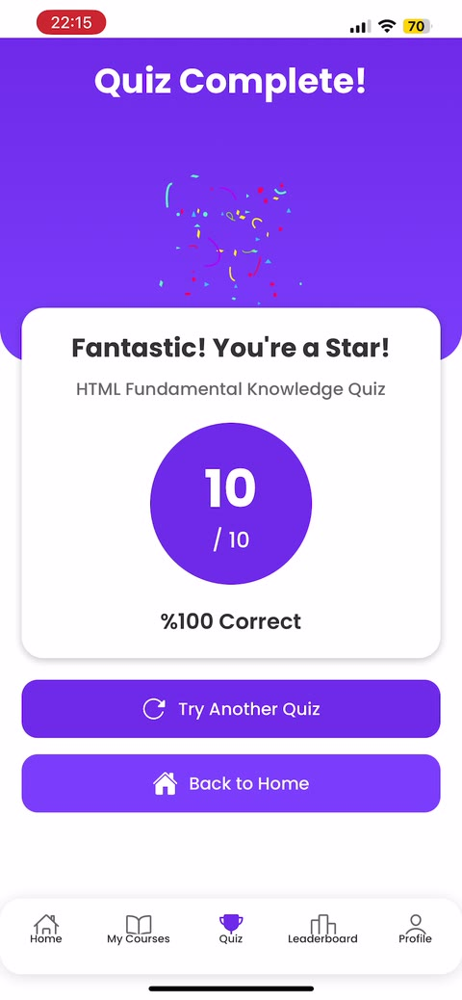<br/><sub><b>Quiz result</b></sub></td>
    <td align="center">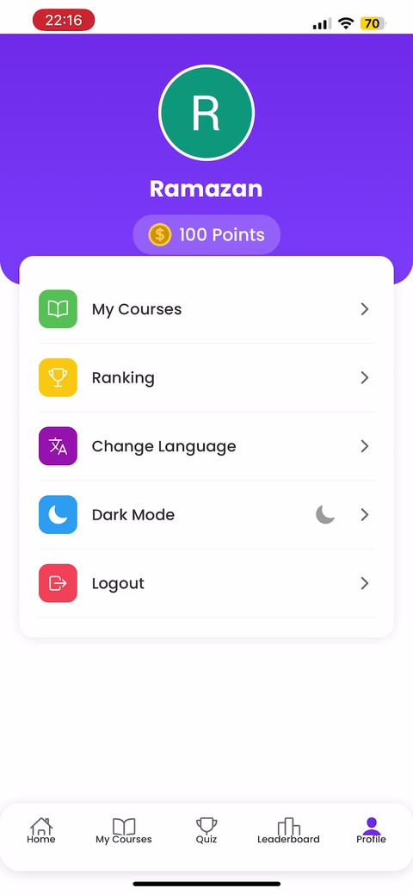<br/><sub><b>Profile</b></sub></td>
  </tr>
</table>

<details>
<summary><b>🌙 Dark mode & 🌍 localisation (click to expand)</b></summary>
<br/>
<table>
  <tr>
    <td align="center">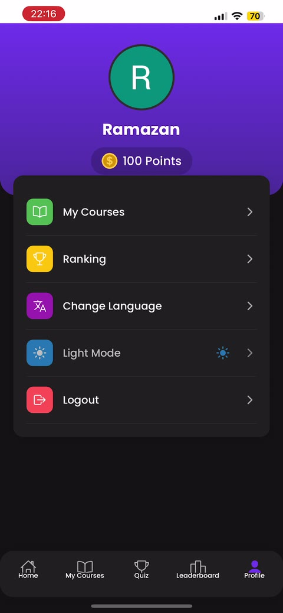<br/><sub><b>Dark profile</b></sub></td>
    <td align="center">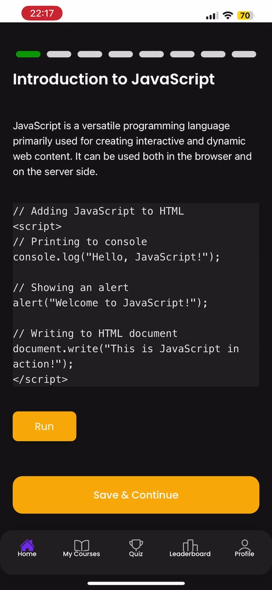<br/><sub><b>Dark lesson</b></sub></td>
    <td align="center">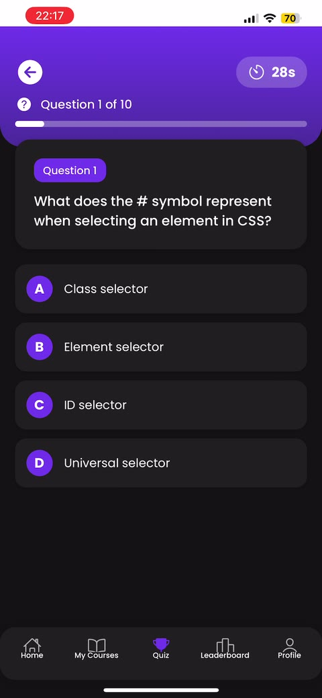<br/><sub><b>Dark quiz</b></sub></td>
  </tr>
  <tr>
    <td align="center">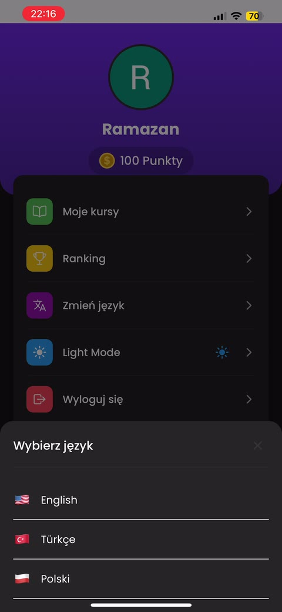<br/><sub><b>Language picker</b></sub></td>
    <td align="center">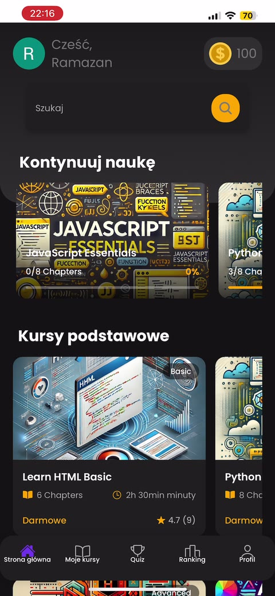<br/><sub><b>Home in Polish</b></sub></td>
    <td align="center">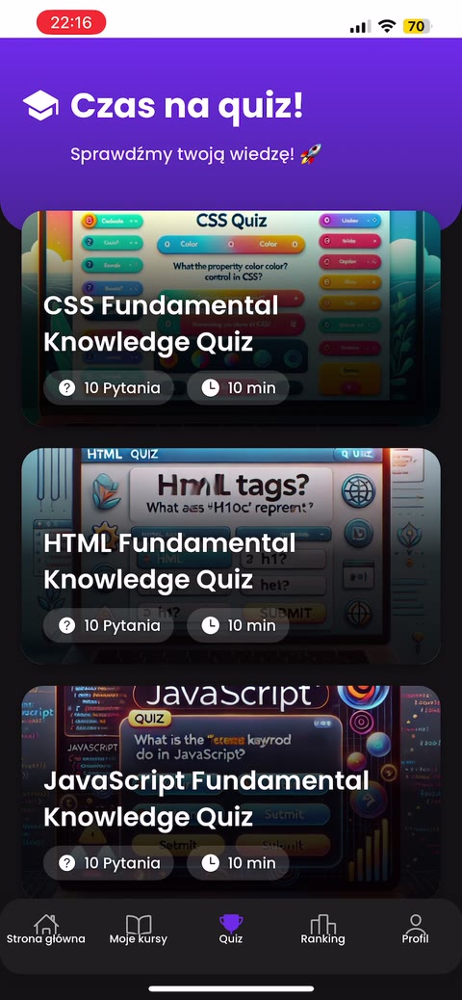<br/><sub><b>Quizzes in Polish</b></sub></td>
  </tr>
</table>
</details>

---

## 🛠️ Tech stack

| Layer | Technology |
|---|---|
| **Framework** | React Native 0.76 + Expo SDK 52 (New Architecture enabled) |
| **Language** | JavaScript (TypeScript-ready config) |
| **Navigation** | React Navigation 7 – bottom tabs + nested stack navigators |
| **Backend / DB** | Firebase Cloud Firestore |
| **Authentication** | Clerk (Google OAuth via `expo-auth-session`, tokens in `expo-secure-store`) |
| **State** | React Context (`User`, `Course`, `Theme`, `Language`, `Toast`) |
| **i18n** | `i18next` + `react-i18next` |
| **UI / Motion** | Lottie animations, `expo-linear-gradient`, `react-native-progress`, `react-native-reanimated`, Poppins font family |
| **Tooling** | Git & GitHub, VS Code, Expo Go |

---

## 🏗️ Architecture

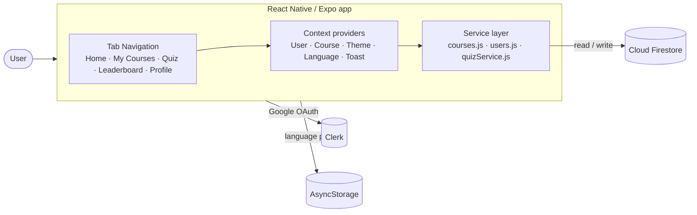

**Firestore data model**

| Collection | Purpose |
|---|---|
| `Courses` → `chapters` (sub-collection) | Course metadata (level, duration, author, banner) and ordered chapter content |
| `UserEnrolledCourse` | Which user is enrolled in which course + completed chapters |
| `users` | Profile and total points (feeds the leaderboard) |
| `quizzes` | Quiz definitions and questions |
| `CourseRatings` | Star ratings submitted after finishing a chapter |

UI components never talk to Firestore directly: all reads/writes go through the `services/` layer, which keeps screens thin and the data logic testable.

---

## 📂 Project structure

```
LearnWise/
├── App.js                 # Providers + auth gate (SignedIn / SignedOut)
├── screens/               # Home, CourseDetail, ChapterContent, Quiz, QuizQuestions,
│                          # QuizResult, Score, LeaderBoard, MyCourse, Profile, Login
├── components/            # Reusable UI split by feature (HomeScreen, CourseDetailScreen, ...)
├── navigations/           # Tab navigator + Home / MyCourse / Quiz stack navigators
├── contexts/              # User, Course, Theme, Language, Toast contexts
├── services/              # Firestore access layer (courses, users, quizzes)
├── i18n/                  # EN / TR / PL translation resources
├── hooks/                 # e.g. warmUpBrowser for OAuth on Android
├── utils/                 # Colour palette
└── assets/                # Fonts, images, Lottie animations
```

---

## 🚀 Getting started

**Prerequisites:** Node.js 18+, npm, and the [Expo Go](https://expo.dev/go) app (or an iOS / Android emulator).

```bash
# 1. Clone
git clone https://github.com/Resan-ramazan/LearnWise.git
cd LearnWise

# 2. Install dependencies
npm install

# 3. Configure environment
#    Create a .env file in the project root:
echo "EXPO_PUBLIC_CLERK_PUBLISHABLE_KEY=your_clerk_publishable_key" > .env

# 4. Run
npx expo start          # then scan the QR code with Expo Go
# or: npm run android  /  npm run ios
```

> **Firebase:** to use your own backend, create a Firebase project with Cloud Firestore enabled and replace the config in `services/firebaseConfig.js`.

---

## 📊 Results

- **User testing with 100+ participants** showed that the gamified flow (points, leaderboard, quizzes) noticeably increased engagement and motivation to keep going.
- **Commercial adoption:** LearnWise was **sold to an education-technology company in Turkey**, which integrated it into its digital learning portfolio and made it available to programming students across the country. The acquirer specifically valued the secure authentication, the gamification layer and the cross-platform codebase.

---

## 🗺️ Possible next steps

- In-app code editor with real code execution (sandboxed)
- Streaks, daily goals and push-notification reminders
- More languages and an **intermediate** level
- AI-generated hints and personalised quiz difficulty
- Unit & E2E tests (Jest, Detox) and CI with EAS Build

---

## 🎓 Academic context

LearnWise was developed as a **Bachelor's thesis** project using a hybrid methodology — up-front Waterfall-style requirements and design, followed by Agile iterations driven by user feedback. The thesis investigates which tools, frameworks and features make a mobile programming-education app effective, accessible and motivating.

---

## 👤 Author

**Ramazan Alkoyun**

[](https://github.com/Resan-ramazan)

If you found this project interesting, consider giving it a ⭐!
